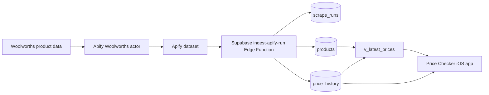
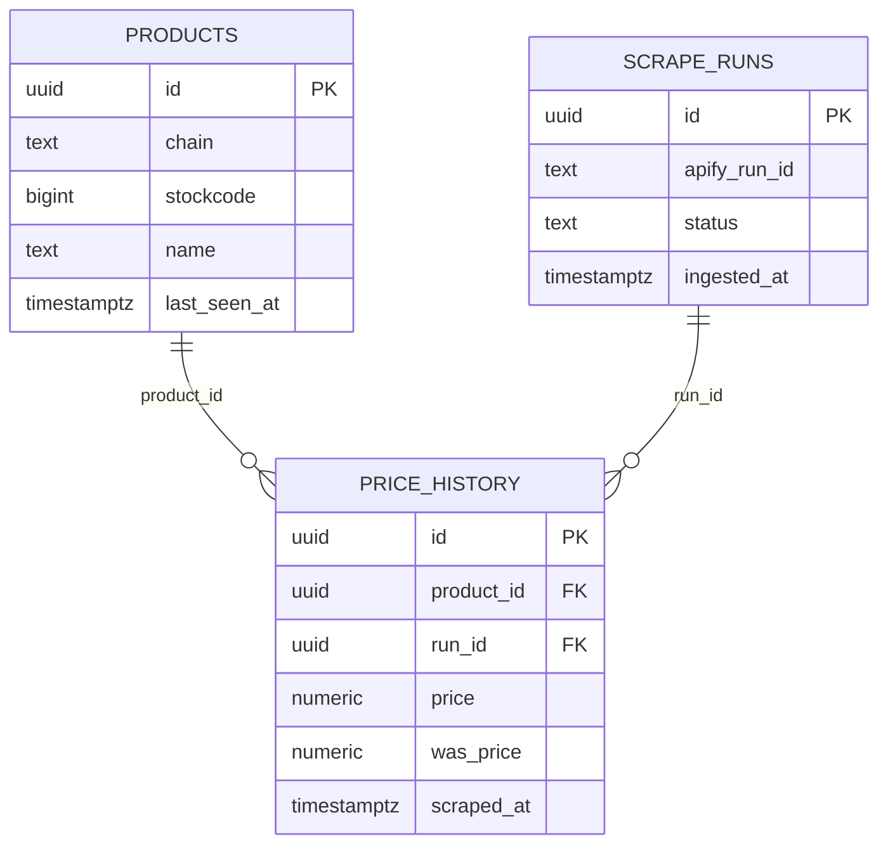

# Papa PriceChecker implementation

This document describes the iOS app and the grocery database it consumes. It reflects the source in this repository and the migrations and ingestion function in the separate `woolworths-actor` project, inspected on 2026-11-17. The documented table and view columns were also checked using read-only requests to the deployed Supabase API. API access confirms that those columns can be selected; it does **not** prove the deployed indexes, grants, policies, constraints or full security configuration match the local migrations.

## Purpose and scope

Papa PriceChecker is an iOS and iPadOS app for finding products collected by the grocery-price pipeline and viewing their recorded price history. Woolworths is the default retailer, and the app discovers additional enabled retailers from Supabase. Public browsing is read-only; the phase-one client also supports optional Sign in with Apple and private favourites once end-to-end validation is complete. It does not search the retailer's entire catalogue: only products collected by the configured actor appear. The app does not schedule or perform scraping, modify public product data, or deploy backend changes.

The user can:

- Browse and search products, load additional results and refresh the list.
- Open a product to see the latest recorded price, retailer link, promotion, comparison unit price, availability and last-seen time when supplied.
- View recorded price snapshots in a chart, switch between one month, three months, one year and all history, and inspect individual snapshots.
- See the lowest and highest recorded price, count of snapshots with a price, and changes from the immediately preceding snapshot when both prices are known.

## Technology and project structure

| Area | Current implementation |
| --- | --- |
| App | Native Swift and SwiftUI; adaptive `NavigationStack` or balanced `NavigationSplitView`, searchable catalog, adaptive vertical/horizontal toolbars with `visibilityPriority`, `reservedRegions(kind: .division)` adaptation, and Light/Dark/High Contrast `Theme` tokens |
| Chart | Apple's Swift Charts, with linear trend lines, gradient area fill, lowest-price rule mark, points, and interactive `.chartXSelection` scrubbing |
| Icons and images | SF Symbols, a universal 1024 × 1024 app icon asset, adaptive Light/Dark `AccentColor`, and `AsyncImage` for product images (white card for loaded photos, tinted card for placeholders) |
| Networking | Foundation `URLSession` and `URLComponents` for public data; Supabase Swift for authenticated data and functions |
| Data decoding | `Decodable` and `JSONDecoder`, with ISO 8601 timestamp parsing, including fractional seconds |
| Concurrency | Swift `async`/`await` and SwiftUI `.task` |
| Persistence | No app-owned database or persistent offline cache is implemented |
| Dependencies | Supabase Swift 2.55.6, pinned through Swift Package Manager; AuthenticationServices and CryptoKit for Apple sign-in |
| Xcode target | `Papa PriceChecker`, bundle identifier `org.nando.Papa-PriceChecker`, iPhone and iPad, minimum iOS/iPadOS 27.2 |
| Swift settings | Project specifies Swift language mode `5.0`, approachable concurrency and `MainActor` default isolation |

The project was built with Xcode 27.2. The target's deployment version is inherited from the initial project setup, not a claim that the app needs a feature exclusive to that release.

| File | Responsibility |
| --- | --- |
| `Papa PriceChecker/Papa_PriceCheckerApp.swift` | App entry point and root window |
| `Papa PriceChecker/ContentView.swift` | Adaptive `NavigationSplitView` browse/detail shell, price movement alert, filter modes, gentle red/green price columns, product detail, interactive chart, snapshot list, loading and error states |
| `Papa PriceChecker/GroceryService.swift` | Supabase REST requests for retailers, browsing, ranked search, price movements, catalog timestamps, product lookup and history |
| `Papa PriceChecker/AccountStore.swift` | Apple sign-in, Supabase session lifecycle, and authenticated favourites operations |
| `Papa PriceChecker/FavouritesView.swift` | Favourite button, sign-in, list and account-deletion UI |
| `backend/phase1/README.md` | Phase-one setup, deployment gates and test results; the canonical migration and function are in the grocery backend repo |
| `Papa PriceChecker/PriceHistoryInsights.swift` | `PriceChangeSummary`, `PriceDirection`, previous-snapshot price comparison, recorded minimum/maximum and priced-snapshot count |
| `Papa PriceChecker/Assets.xcassets/` | App icon and adaptive Light/Dark `AccentColor` assets |
| `Tests/PriceHistoryChecks.swift` | Standalone checks for history decoding and calculations; not an Xcode test target |
| `Papa PriceChecker.xcodeproj/` | Xcode project and build settings |

The backend source is maintained separately at `/Users/fernandodeleon/dev/NandoProjects/GroceryActor-apify/woolworths-actor`. Its `architecture.md`, `supabase/migrations/` and `supabase/functions/ingest-apify-run/index.ts` are the source references for the schema and ingestion behavior below. Backend migrations are not maintained or deployed from the iOS app repository.

## End-to-end data flow



1. The Apify actor collects configured Woolworths search results and writes an Apify dataset. A successful actor-run webhook invokes the Supabase Edge Function.
2. The function fetches the dataset and run details, deduplicates products by `(chain, stockcode)`, and upserts the run and product catalogue. It updates `products.last_seen_at` when a product is encountered.
3. The function compares each product with its latest history record. It writes a snapshot for a new product, or if `price`, `was_price`, `is_on_special`, `is_half_price`, `promotion` or `is_available` has changed.
4. Supabase exposes the `v_latest_prices` view and `price_history` table through PostgREST. The app makes read-only requests with the project's publishable key.

The expected upstream schedule is one run each day at 9 am, as described by the project owner. This app does not configure or verify that schedule, its time zone, or whether a particular run succeeds. `last_seen_at` is the product's last recorded encounter, not a guarantee that the latest price is still available at a specific store.

## App requests and UI behavior

### Browse and search

`GroceryService.products(chain:search:offset:)` reads `public.v_latest_prices` with a chain filter and calls `GET /rest/v1/rpc/search_products_by_chain` with `retailer_chain`, `search_text`, `page_size` and `page_offset` for a nonempty search. The RPC filters by retailer before ranking and pagination. If the RPC is missing, a Woolworths search uses the existing `search_products` RPC with a response filter during the Woolworths-only rollout. Price-movement summaries read `(product_id, price)` from `public.price_history` for the selected chain, then resolve changed products within that chain. Favourites and product detail use the product UUID. Opening a favourite from an enabled retailer switches the catalog to that retailer and loads its snapshot timestamp.

- An empty search browses alphabetically and prioritizes items with recorded price changes in the UI. A nonempty search ranks exact names, full-text phrases, names containing all query terms, case-insensitive substrings, multi-word prefix matches (`english` and `simple` `:*` type-ahead), then likely typos. Within the all-terms and prefix tiers, PostgreSQL's `ts_rank_cd` favours closer term matches. Search uses product names as its input.
- The typo tier uses `pg_trgm` word similarity at a threshold of 0.55. A fuzzy term must contain at least four letters, and every searchable term must either match or meet the threshold. Results use name and product ID to break relevance ties.
- Search is an inline field in the catalog, so its position follows the available content area after an orientation change. The UI keys its root query task by chain and search text and waits 300 ms before querying. Retailer changes clear the previous catalog, price summaries and detail selection. Browse and search use pages of 50 and an explicit **Load more products** action.
- An adaptive hero card summarizes loaded and on-special counts in regular vertical height and collapses into a compact single-line strip when `verticalSizeClass == .compact` or during an active search.

The backend migration `supabase/migrations/20261118204414_ranked_product_search.sql` enables `pg_trgm` and adds the read-only, security-invoker RPC for anonymous and authenticated clients. `supabase/migrations/20261120100836_optimize_product_search.sql` adds `simple` `tsvector`, `pg_trgm`, and `(chain, lower(name), id)` indexes on `public.products`, adds the prefix matching tier, and scores and paginates `public.products` (excluding unpriced items) before joining the latest `price_history` snapshot for the winning page. It returns the latest-price view's row type, so the existing product decoder also handles search results. The earlier migration-history mismatch described in [phase-one setup](backend/phase1/README.md) needs reconciliation before a general database push. The ranked search SQL regression check lives at `supabase/tests/ranked_product_search.sql` in the grocery backend and runs against a disposable database with the grocery migrations applied.

### Retailer rollout

1. Apply the backend's `20261119020836_retailer_catalogs.sql` migration in staging and run `supabase/tests/retailer_catalogs.sql` against a disposable database. The migration seeds Woolworths as enabled and ALDI as disabled. Anonymous and authenticated users can read enabled retailer rows. The registry controls the picker and ranked search. The existing product and history endpoints still expose the public catalog.
2. Point a Debug app at the staging project using the scheme's run environment. Set both `PAPA_PRICECHECKER_SUPABASE_URL` to the HTTPS project URL and `PAPA_PRICECHECKER_SUPABASE_PUBLISHABLE_KEY` to its publishable key. Without overrides, the app uses the configured production project. Release builds use the production configuration.
3. Configure the successful-run webhook for the ALDI Apify task against staging. Use one retailer per dataset and keep its `chain` value lowercase and consistent. Import two runs and check stable product IDs, changed-price history and distinct run timestamps. Verify promotions and availability against ALDI because the sample has no flagged specials and defaults unspecified availability to true.
4. Enable ALDI in the staging registry after verifying the imports. Check the picker, browse, ranked search and pagination, price-movement alerts, favourites and product links. For a future feed, add its chain and display name to the same registry and enable it after validation.
5. Before any production ALDI import, reconcile the backend migration history and resolve compatibility for older app builds. The legacy search RPC stays Woolworths-only with this migration, but older apps still browse the shared latest-price view without a chain filter.
- Below the hero card when browsing, an interactive two-column **Price Movement Alert** shows catalog-wide **Price Drops** and **Price Rises** from the latest available checks. A later unchanged check removes an older movement from the count and filters. Tapping either card filters the list directly.
- Loaded products can be filtered between **All**, **Drops**, **Rises**, and **Specials** via horizontal filter chips or the sidebar toolbar filter menu (`visibilityPriority(.high)`), alongside refresh (`visibilityPriority(.low)`).
- The list can be pulled to refresh. Loading, empty, filter-empty, error and retry states are provided.
- The catalog timestamp above the product list comes from a one-row `scrape_runs` read scoped to the selected retailer. The query takes the latest non-null `finished_at` from a successful scrape whose final `products_upserted` count is positive. This includes completed imports with zero price changes. Displaying `finished_at` dates the scrape itself, including after an import replay. The timestamp is localized to the device and its absence leaves browsing and search available.
- Product rows present brand overline, full wrapping product name, package size with unit price, price-change/specials/availability pills, a trailing price column tinted gentle red (`Theme.priceRiseColumnSurface`) with `arrow.up.right.circle.fill` for increases or gentle green (`Theme.priceDropColumnSurface`) with `arrow.down.right.circle.fill` for reductions (plus previous snapshot price), Accessibility Dynamic Type stacking, and split-view selection highlighting.
- Product images are loaded from the URL in the catalogue onto a crisp white card; products without a loaded image display a soft brand-tinted basket placeholder.

### Product history

`GroceryService.history(productID:)` reads `public.price_history` for one product, in `scraped_at` then `id` ascending order, fetching pages of 500 until the final page. It selects the snapshot ID, price and was price, savings, discount percentage, special and multibuy flags, promotion, order limit, comparison unit-price fields, availability, region and scrape time. Rows are displayed newest first.

Narrow windows use a `NavigationStack` and push `ProductDetail`. Regular windows at least 600 points wide place it beside the catalog in a `NavigationSplitView`. The app measures the window separately from keyboard avoidance so a keyboard opening in a short window cannot recreate the navigation container or discard search focus. Changes in layout, orientation, or fold division still rebuild the container and preserve the selected product, retailer, and search text. The catalog measures the space given to its rows and stacks the price below the description on narrow widths or at accessibility text sizes. When `reservedRegions(kind: .division)` reports an active vertical fold division inside the detail container, `ProductDetail` places the header and chart cards side by side across the division and widens grid spacing to clear the hinge.

The chart range affects the chart only. Summary statistics cover all loaded history. The chart can carry a known price into the selected range from an earlier observation. If the product has a known price and `last_seen_at` is newer than its latest snapshot’s `scraped_at`, the chart adds a selectable endpoint at `last_seen_at` and holds the price flat to that point. It leaves missing historical prices unconnected. Tick labels include the most recent displayed date and avoid duplicate labels. When the latest catalog snapshot falls on a later day, a dashed segment carries the last known price from the product’s last check through the catalog date. The segment uses the latest priced snapshot and adds no new observation. Each recorded snapshot’s change is calculated against the immediately preceding snapshot when both prices are known.

The record list exposes promotion and saving information when supplied, with expandable was price, discount, unit price, multibuy, order-limit, availability and region details. Null or empty values are generally omitted. The product list and detail show an unchanged price when a later check confirms the last recorded price or the latest two snapshots agree. A history record’s `scraped_at` is when that particular state was observed. The header also provides **View at Woolworths** and **Share** actions when an HTTPS product URL is available.

### Important interpretation of snapshots

History is **change-only**, not a daily time series. The pipeline does not create a new history row solely because `savings_amount`, `is_multibuy`, `product_limit`, unit-price fields, `source` or `region` changes. Those fields reflect what the pipeline wrote when a snapshot was created; they are not necessarily refreshed on each later product check. An unchanged shelf price can therefore have an old snapshot date and a newer product last-seen time. A single snapshot cannot establish earlier price behavior, and the lowest/highest figures are only for captured history.

Prices are formatted as Australian dollars in the app. Availability and price can vary by region, retailer conditions and time. The database represents currency values as PostgreSQL `numeric`; the current Swift decoding and calculations use `Double`.

## Supabase configuration and security

- The client targets project `grocery-prices`, project reference `wntllezsoavodlrpqcue`, at `https://wntllezsoavodlrpqcue.supabase.co/rest/v1`.
- The project URL and a **publishable** key are currently embedded in `GroceryService.swift`, and the client sends the key in the `apikey` and bearer authorization headers. The publishable key is a public client identifier, not a secret; never put a secret or service-role key in the iOS bundle.
- Anonymous reads of product and price-history queries work without an account. The phase-one client implements optional native Apple sign-in and authenticated favourites via Supabase Auth; the favourites table and its policies were applied through the SQL editor on 2026-11-18, and the deletion function was deployed on 2026-11-18 with JWT verification; the Apple provider was enabled on 2026-11-18; the migration history still needs reconciliation. See `backend/phase1/README.md`.
- The backend migration enables row-level security on all three tables and defines `SELECT` policies for the `anon` and `authenticated` roles. It does not define public write policies. Both views use `security_invoker = true` in the local migrations, so callers are subject to the underlying table permissions and policies.
- The migration also grants anonymous read policy access to `scrape_runs`. The app selects only `finished_at` for the catalog timestamp. Decide whether all run metadata should remain public when auditing the backend.
- Read-only requests cannot establish the absence of write access or prove deployed RLS configuration. Review live grants, policies, view settings and exposed columns independently before release; do not rely on hiding the publishable key for security.
- Administrative ingestion credentials belong only in the backend environment. The iOS app makes no calls to the ingestion function.

## Phase-one account architecture

The app uses a cryptographically random nonce and SHA-256 for native Sign in with Apple, then exchanges the Apple identity token through Supabase Auth. The SDK manages the session using platform-secure storage. `AccountStore` reads and modifies only the signed-in user’s `user_favourites` rows; rows are loaded in pages and cleared when the user signs out or changes accounts. The product list remains public. Users can initiate account deletion after a fresh authorization with the same Apple account. The proposed Edge Function verifies both the Supabase user and fresh Apple identity, attempts to revoke the Apple authorization, and deletes that user through the server-side admin API. Its server-only secrets are configured and the function is deployed, but authenticated deletion and revocation still need end-to-end validation.

The migration adds `user_favourites(user_id, product_id, created_at)` with a composite primary key, foreign keys cascading from Auth users and products, and select/insert/delete RLS policies restricted to `auth.uid()`. It grants no access to `anon` and no update privilege. The migration, deletion function and their tests are uncommitted local changes in the grocery backend repository, which remains their deployment owner. The table was applied through the dashboard, so migration version `20261118000001` is not recorded in the hosted migration history; reconcile the existing version mismatch and this missing record before any CLI push. The client does not implement notification delivery.

## Database schema

The current grocery schema definitions below come from backend migrations `20261117000001_create_grocery_schema.sql` and `20261117000002_add_last_seen_to_views.sql`. All tables and views are in `public`. A nullable column can contain SQL `NULL`; `NOT NULL` and defaults are as specified by the migrations. Monetary and comparison-price values are in Australian dollars unless otherwise stated.



### `products`

One catalogue row per `(chain, stockcode)`. `v_latest_prices` joins this table to history. The app does not query `products` directly.

| Column | PostgreSQL type | Null / default | Meaning |
| --- | --- | --- | --- |
| `id` | `uuid` | NOT NULL, `gen_random_uuid()` | Primary key |
| `chain` | `text` | NOT NULL, `'woolworths'` | Retail chain; part of unique key |
| `stockcode` | `bigint` | NOT NULL | Retailer product code; unique with `chain` |
| `barcode` | `text` | nullable | Product barcode |
| `name` | `text` | NOT NULL | Product name |
| `brand` | `text` | nullable | Brand |
| `package_size` | `text` | nullable | Pack size text |
| `departments` | `text[]` | nullable | Retailer departments |
| `category` | `text` | nullable | Product category |
| `url` | `text` | nullable | Retailer product URL |
| `image_url` | `text` | nullable | Product image URL |
| `first_seen_at` | `timestamptz` | NOT NULL, `now()` | When the catalogue row was first created |
| `last_seen_at` | `timestamptz` | NOT NULL, `now()` | Product's latest recorded scrape/encounter |
| `updated_at` | `timestamptz` | NOT NULL, `now()` | Last catalogue update timestamp |

### `price_history`

A row is a captured product state, created on first observation or when one of the monitored fields changes. The app queries this table by `product_id`.

| Column | PostgreSQL type | Null / default | Meaning |
| --- | --- | --- | --- |
| `id` | `uuid` | NOT NULL, `gen_random_uuid()` | Primary key |
| `product_id` | `uuid` | NOT NULL | References `products.id`; cascade delete |
| `run_id` | `uuid` | NOT NULL | References `scrape_runs.id`; cascade delete; unique with `product_id` |
| `chain` | `text` | NOT NULL, `'woolworths'` | Retail chain |
| `stockcode` | `bigint` | NOT NULL | Retailer product code |
| `price` | `numeric(10,2)` | nullable | Recorded shelf price |
| `was_price` | `numeric(10,2)` | nullable | Retailer's comparison price, not necessarily the prior recorded price |
| `savings_amount` | `numeric(10,2)` | nullable | Retailer-provided amount saved |
| `discount_pct` | `numeric(5,2)` | generated, nullable | Rounded percentage `(was_price - price) / was_price × 100` when `was_price > price`, `was_price > 0` and `price` is present; otherwise null |
| `is_on_special` | `boolean` | NOT NULL, `false` | Recorded special flag |
| `is_half_price` | `boolean` | NOT NULL, `false` | Recorded half-price flag |
| `promotion` | `text` | nullable | Promotion description |
| `is_multibuy` | `boolean` | NOT NULL, `false` | Recorded multibuy flag |
| `product_limit` | `integer` | nullable | Recorded retailer order limit |
| `cup_price` | `numeric(10,2)` | nullable | Comparison unit price |
| `cup_measure` | `text` | nullable | Comparison measure, such as `100G` |
| `cup_string` | `text` | nullable | Formatted unit price supplied by the source |
| `is_available` | `boolean` | nullable | Availability at the time and region observed; null means unknown |
| `source` | `text` | nullable | Ingestion source/search-term tags |
| `region` | `text` | nullable | Source region associated with the scrape |
| `scraped_at` | `timestamptz` | NOT NULL | When the product state was observed |
| `created_at` | `timestamptz` | NOT NULL, `now()` | When the database row was inserted |

The unique `(run_id, product_id)` constraint allows at most one snapshot for a product in a given run. Deleting a referenced product or run cascades to its history rows according to the migration.

### `scrape_runs`

Ingestion metadata for actor runs. The app queries it for the catalog timestamp.

| Column | PostgreSQL type | Null / default | Meaning |
| --- | --- | --- | --- |
| `id` | `uuid` | NOT NULL, `gen_random_uuid()` | Primary key |
| `apify_run_id` | `text` | NOT NULL, UNIQUE | Apify run identifier, or an ingestion fallback identifier |
| `actor_id` | `text` | nullable | Apify actor identifier |
| `dataset_id` | `text` | nullable | Apify dataset identifier |
| `chain` | `text` | NOT NULL, `'woolworths'` | Retail chain |
| `status` | `text` | NOT NULL, `'SUCCEEDED'` | Run status |
| `search_terms` | `text[]` | nullable | Search terms associated with ingestion |
| `items_received` | `integer` | NOT NULL, `0` | Dataset item count |
| `products_upserted` | `integer` | NOT NULL, `0` | Number of products processed |
| `price_records_inserted` | `integer` | NOT NULL, `0` | Count of changed snapshot rows processed |
| `started_at` | `timestamptz` | nullable | Run start |
| `finished_at` | `timestamptz` | nullable | Run finish |
| `ingested_at` | `timestamptz` | NOT NULL, `now()` | Last ingestion timestamp written for the run |

### Views

- **`v_latest_prices`** joins each product with its most recent `price_history` row using `DISTINCT ON (p.id)` ordered by product ID and descending `scraped_at`. Products without a history row are excluded by the inner join. It exposes catalogue fields and the latest snapshot, including `last_seen_at` from `products`. The app reads this view for product search and browsing. The migration does not define a secondary tie-breaker for identical `scraped_at` values.
- **`v_current_specials`** filters `v_latest_prices` to rows with a special flag, a half-price flag, a non-null promotion, or a was price above the current price. The view definition orders by discount percentage and savings descending, nulls last. The app does not currently query this view.

### Indexes in the migration

- `products_chain_stockcode_key`: unique constraint on `(chain, stockcode)`; the migration also creates `idx_products_chain_stockcode` on the same columns.
- `idx_products_name`: GIN index on `to_tsvector('english', name)`. The ranked RPC scores the latest-price rows across full-text, substring and trigram matches. Verify its query plan as the catalog grows before assuming this index accelerates the RPC.
- `idx_price_history_product_scraped`: `(product_id, scraped_at DESC)`.
- `idx_price_history_specials`: partial index on `is_on_special` for rows where it is true.
- The primary keys and unique `(run_id, product_id)` constraint also create supporting indexes.

## Build and verification

On a Mac with Xcode 27.2 and its iOS SDK installed, open `Papa PriceChecker.xcodeproj` and run the `Papa PriceChecker` scheme. An unsigned command-line build is:

```sh
xcodebuild -project 'Papa PriceChecker.xcodeproj' -scheme 'Papa PriceChecker' \
  -configuration Debug -sdk iphoneos CODE_SIGNING_ALLOWED=NO build
```

Run the local decoding and history-logic checks:

```sh
xcrun swiftc -module-cache-path /tmp/papa-pricechecker-swift-modules \
  'Papa PriceChecker/GroceryService.swift' 'Papa PriceChecker/PriceHistoryInsights.swift' \
  Tests/PriceHistoryChecks.swift -o /tmp/papa-pricechecker-history-checks
/tmp/papa-pricechecker-history-checks
```

The checks cover populated promotion fields, null prices, min/max/count calculations, and not comparing across a missing-price snapshot. Phase-one RLS and mocked account-deletion checks are described in `backend/phase1/README.md`. The app's search and history requests have also been checked against live read-only Supabase data. Those checks do not substitute for an audit of deployed security policies, simulator UI validation, or physical-device testing. Xcode and Apple's SDK require macOS; a normal Linux container cannot provide the iOS build environment.

Before release, validate search and history against expected products, large histories and network failures; test Dynamic Type, VoiceOver, dark/tinted appearance, compact and expanded layouts, and iPhone Duo fold transitions on suitable simulators and devices. The app currently has no automated UI test target, no offline data store, no notification delivery; favourites require the phase-one backend deployment and real-device validation.
